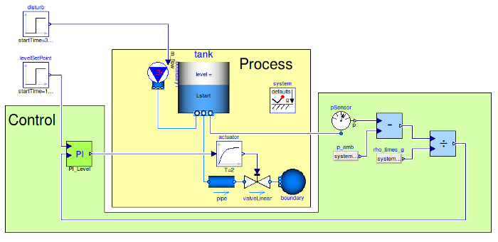

# IndustrialControlSystems

## Library description

Package Industrial Control Systems is a library that is developed with the [Modelica language](https://www.modelica.org) and provides a set of continuous and discrete control systems.
This library can be used to set up or replicate the majority of industrial controllers.

The first version of the library has been presented at the 9th Modelica conference,
held in Munich 3-5 September 2012, see [paper](http://dx.doi.org/10.3384/ecp12076477). The library won the 2nd prize at the Modelica library competition award.

## Releases

- IndustrialControlSystems v2.0.1 (unreleased): Modelon Impact compatibility, MSL 4.1.0, controller bug fixes, documentation and regression tests
- IndustrialControlSystems v2.0.0 (2024-08-07)
- IndustrialControlSystems v1.2.0 (2024-08-07)

The full release notes are in `IndustrialControlSystems.UserGuide.ReleaseNotes`.

### Version 2.0.1 (unreleased)

The changes proposed upstream in PRs [#2](https://github.com/looms-polimi/IndustrialControlSystems/pull/2) to [#6](https://github.com/looms-polimi/IndustrialControlSystems/pull/6). Issue numbers refer to the [fork's issue tracker](https://github.com/hubertus65/IndustrialControlSystems/issues), where each fix was reviewed.

#### Compatibility and maintenance ([#2](https://github.com/looms-polimi/IndustrialControlSystems/pull/2))

- Uses Modelica Standard Library 4.1.0. No conversion is needed from 2.0.0 (`noneFromVersion="2.0.0"`); the conversion script from 1.1.0/1.2.0 moved to `Resources/Scripts/Conversion`.
- Compatible with Modelon Impact / OCT: conditional components used as the Modelica specification allows, an illegal `noEvent()` in a `when` clause removed, a function output given an explicit size.
- Images and references moved from the Dymola-specific `help` folder to `Resources/Images` and `Resources/References`, referenced with `modelica://` URIs.
- MSL-style package icons.
- Typos in class names fixed:
  - `MathOperations.RealType.Signals.SmoothThooth` → `SmoothTooth`
  - `MathOperations.RealType.Signals.SmoothThoothSignal` → `SmoothToothSignal`
  - `Applications.TrasferFunctions` → `Applications.TransferFunctions`
  - `Logical.LogicalOperations.Examples.FliFlop` → `FlipFlop`

  The two signal blocks keep their old names as obsolete classes that extend the new ones, so models built with 2.0.0 still work. The other two are examples.

#### Bug fixes that change simulation results ([#2](https://github.com/looms-polimi/IndustrialControlSystems/pull/2), [#5](https://github.com/looms-polimi/IndustrialControlSystems/pull/5), [#6](https://github.com/looms-polimi/IndustrialControlSystems/pull/6))

Each fix changes results only for the configurations listed. Regenerate the reference results of models that use them.

- `Controllers.PD` now has proportional action, and `CS_start` is its initial output. **Results of all models using `PD` change.** ([#2](https://github.com/looms-polimi/IndustrialControlSystems/pull/2), [issue 4](https://github.com/hubertus65/IndustrialControlSystems/issues/4))
- Continuous `Controllers.I` with `useBIAS = true` no longer ramps at `Bias/eps`. ([#2](https://github.com/looms-polimi/IndustrialControlSystems/pull/2), [issue 3](https://github.com/hubertus65/IndustrialControlSystems/issues/3))
- Gain scheduling (`useGS`) now works in the sampled versions (`Ts > 0`) of `P`, `PI` and `I`. ([#2](https://github.com/looms-polimi/IndustrialControlSystems/pull/2), [issue 5](https://github.com/hubertus65/IndustrialControlSystems/issues/5))
- Tracking mode outputs `CS = TR` without the bias in all controllers. ([#2](https://github.com/looms-polimi/IndustrialControlSystems/pull/2), [issue 6](https://github.com/hubertus65/IndustrialControlSystems/issues/6))
- Bumpless return from tracking to automatic mode in `PI`, `PID`, `I` and the PI autotuners. `P`, `PD` and `D` have no integral state and still step. ([#2](https://github.com/looms-polimi/IndustrialControlSystems/pull/2))
- `I`, `PI` and `D` start at `CS_start` in every configuration (with anti-windup, sampled `I`, `D`). ([#5](https://github.com/looms-polimi/IndustrialControlSystems/pull/5), [issue 15](https://github.com/hubertus65/IndustrialControlSystems/issues/15))
- `PID` starts at `CS_start`, without a derivative kick. **The start-up of all models using `PID` with a nonzero initial error, bias or `CS_start` changes**; the closed-loop steady state does not. ([#6](https://github.com/looms-polimi/IndustrialControlSystems/pull/6), [issue 17](https://github.com/hubertus65/IndustrialControlSystems/issues/17))

#### New features ([#3](https://github.com/looms-polimi/IndustrialControlSystems/pull/3))

- `Controllers.PI`: option `initFromFBstart` (default `false`) to start the reset state at a given `FBstart` instead of computing it from `CS_start`.
- New example package `Applications.ControlStrategies` with `LeadLagFilter`: a lead-lag filter that compensates the phase lag of a noise low-pass filter.

#### Documentation ([#3](https://github.com/looms-polimi/IndustrialControlSystems/pull/3))

- HTML documentation added or expanded for about 100 classes; descriptions added to every class and variable that had none.

#### Regression tests ([#4](https://github.com/looms-polimi/IndustrialControlSystems/pull/4), [#5](https://github.com/looms-polimi/IndustrialControlSystems/pull/5), [#6](https://github.com/looms-polimi/IndustrialControlSystems/pull/6))

New models in `Controllers.Examples`, each with its expected values in its documentation: `TestI_biasNoDrift`, `TestPD_proportional`, `TestGainScheduling`, `TestTracking_bias`, `TestTracking_bumpless`, `TestPI_initFromFBstart`, `TestInit_CSstart`, `TestPID_initCSstart`.

### Version 2.0.0 (2024-08-07)

The same as 1.2.0, but it works with MSL 4.0.0. Technically it is not backwards compatible with 1.2.0, because it depends on the non-backwards compatible MSL 4.0.0. In practice the conversion script only affects the examples and applications in the library, not the blocks.

### Version 1.2.0 (2024-08-07)

Adds gain scheduling to the analog P and PI controllers and fixes some Modelica language issues.

## Main authors

Marco Bonvini and Alberto Leva

Maintenance contributors: Thomas Beutlich, Francesco Casella, Peter Harman, Matthis Thorade, Martin Sjoelund, Dietmar Winkler, Hubertus Tummescheit (Model Based Innovation LLC).
